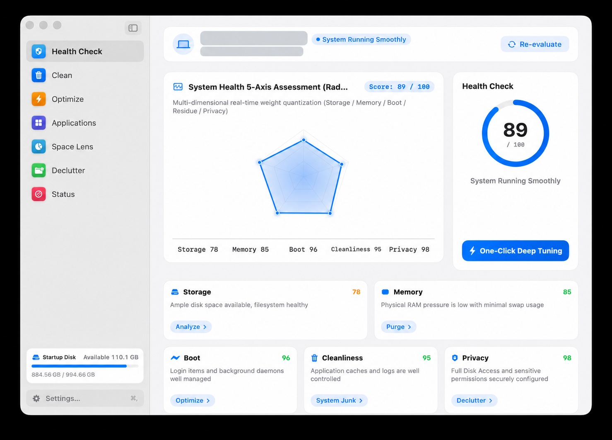
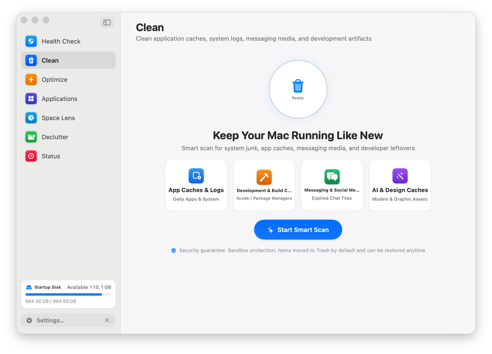
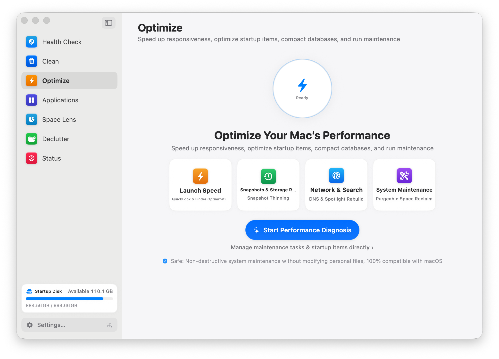
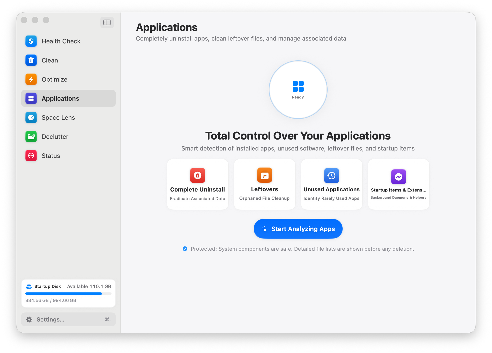
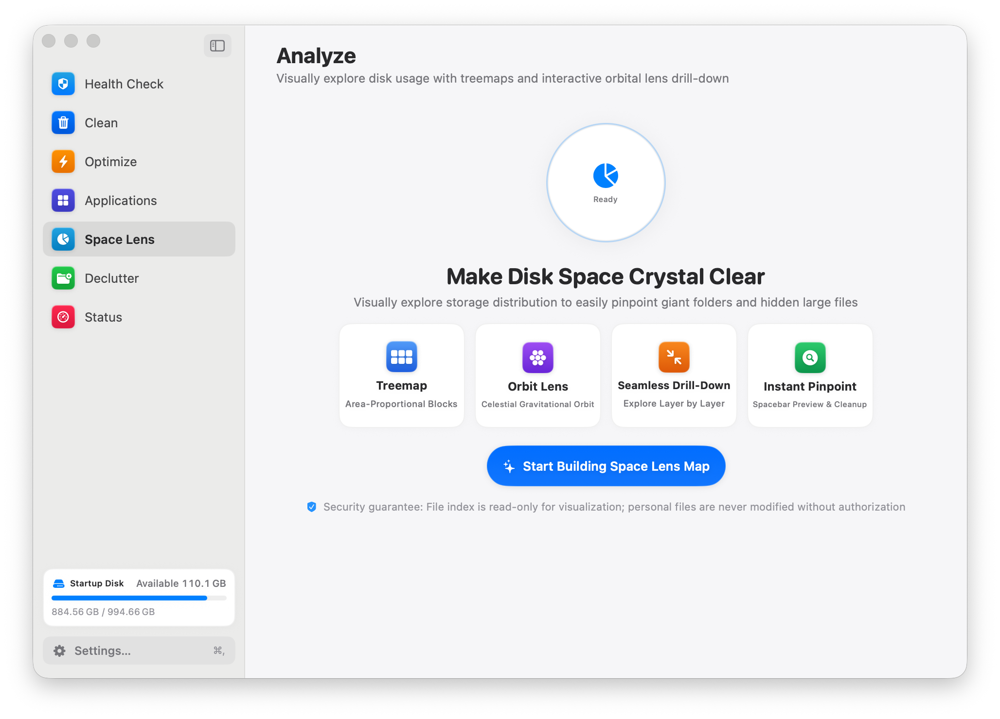
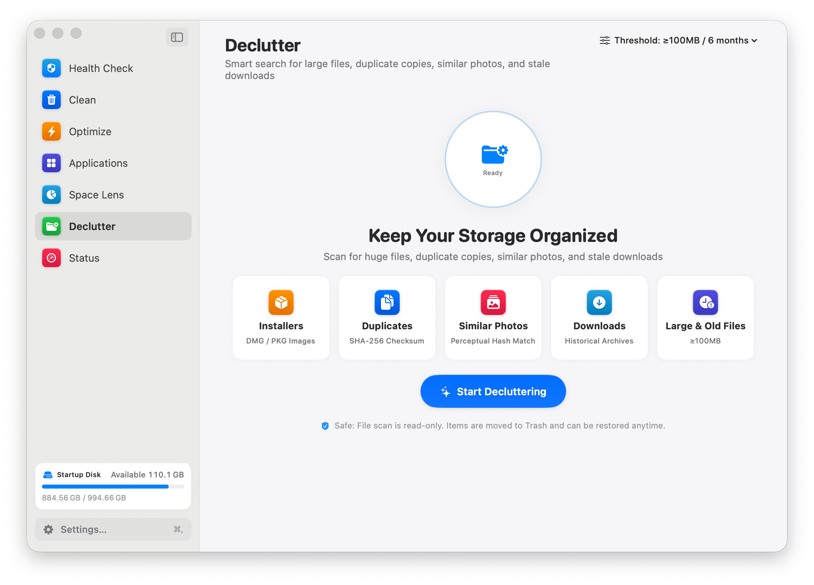
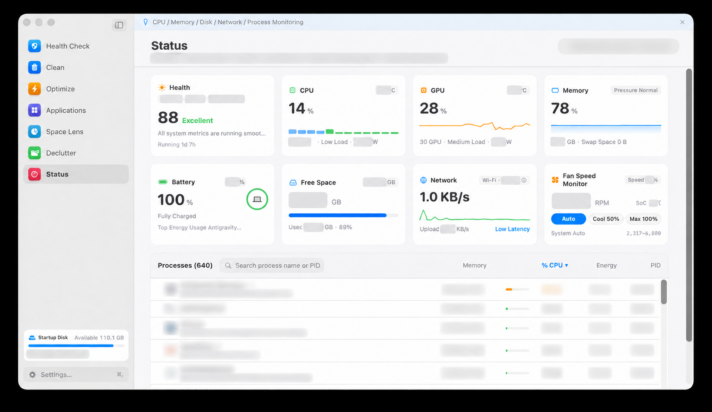

<p align="center"></p>

<h1 align="center">AClean</h1>

<p align="center"><strong>A cleaner, clearer Mac.</strong></p>

<p align="center"><a href="https://github.com/letmetodo/aclean-mac/stargazers"></a>  <a href="LICENSE"></a></p>

**AClean は、クリーニング、ディスク分析、アプリの削除、システム監視を行う macOS ネイティブアプリです。**

スキャン結果を確認してから操作でき、ディスク使用量を可視化し、アプリのアンインストール時に関連ファイルを確認できます。

Language: [简体中文](README.zh-CN.md) · [繁體中文](README.zh-TW.md) · [English](README.md) · [日本語](README.ja.md) · [한국어](README.ko.md) · [Français](README.fr.md) · [Deutsch](README.de.md) · [Español](README.es.md) · [Italiano](README.it.md) · [Português (Brasil)](README.pt-BR.md)

## ✨ スマートクリーニング · Space Lens · アプリ管理 · ライブモニター

- **スマートクリーニング** — 対応するアプリ、開発ツール、システムキャッシュをスキャンし、削除前に候補を確認します。
- **Space Lens** — 可視化されたツリーマップでディスク使用量を確認します。
- **アプリ管理** — インストール済みアプリと関連ファイルを削除前に確認します。
- **ライブモニター** — システムの動作を確認し、メニューバーウィジェットを設定します。
- Interface languages: Simplified Chinese, Traditional Chinese, English, Japanese, Korean, French, German, Spanish, Italian, and Brazilian Portuguese.


## 🌟 AClean の特長

- **ネイティブアプリ自体がオープンソースです。** AClean の SwiftUI アプリは Apache-2.0 で公開されています。プロジェクトによって公開範囲は異なります。Mole のドキュメントでは、無料のオープンソース CLI と別の有料 Mac アプリを区別しており、公開リポジトリには Mac アプリのソースコードは含まれていません（[Mole for Mac](https://github.com/tw93/Mole-App)）。
- **複数の作業を一つのネイティブアプリに集約。** クリーンアップ候補の確認、ツリーマップによるディスク分析、アプリ削除前の関連ファイル確認、システムの健康状態の確認、メニューバーからの状態チェックを行えます。
- **確認してからクリーンアップ。** 実行前に、対応する候補とその場所を表示し、選択内容を確認できます。
- **10言語に対応。** アプリのインターフェースと README を10言語で用意しています。
- **ネットワーク利用を明示。** 任意のルール更新、天気、IP位置情報機能はネットワークを使用します。詳細は「クリーンアップとプライバシー」とソースコードをご覧ください。

## 📸 アプリ画面

<table>
<tr><td align="center"><br /><sub>ヘルスチェック</sub></td><td align="center"><br /><sub>クリーン</sub></td></tr>
<tr><td align="center"><br /><sub>最適化</sub></td><td align="center"><br /><sub>アプリケーション</sub></td></tr>
<tr><td align="center"><br /><sub>Space Lens</sub></td><td align="center"><br /><sub>整理</sub></td></tr>
<tr><td align="center"><br /><sub>システム状態</sub></td></tr>
</table>


## 🧰 Requirements

- macOS 13 以降
- Swift 6.0 以降を含む Xcode Command Line Tools（または Xcode 16 以降）

## ソースからビルド

```bash
git clone https://github.com/letmetodo/aclean-mac.git
cd aclean-mac
./build.sh --local
```

AClean は Swift と macOS SDK で構築されています。ローカルビルドは Apple Silicon 向けです。 Downloadable builds, when available, will be listed in [Releases](https://github.com/letmetodo/aclean-mac/releases). Run the test suite with `./Tests/run_tests.sh`.

## 🔐 Cleanup and privacy

AClean は削除前にスキャン候補を表示します。実行前に選択項目と場所を確認してください。動作はバージョンによって異なるため、ソースとリリースノートを確認してください。ルール更新、天気、IP ベースの位置情報などの任意のネットワーク機能があります。すべての機能がオフラインで動作するとは限りません。

## 🤝 Contributing

Issue と Pull Request を歓迎します。macOS と AClean のバージョン、再現手順、個人情報を除いたログを記載してください。

## 📜 License

Licensed under the [Apache License 2.0](LICENSE).

## 🧭 Project references

Clean-Me、Harbofly、MacSai、Mole、Pearcleaner、PureMac、ClearDisk、Tencent Lemon Cleaner、Lume、mac-cleaner-cli、mac-cleanup-py、mac-cleanup-sh、Purge、Xcode DevCleaner、MacSweep、Privacy Guides を機能と安全設計の調査で参考にしました。独立したプロジェクトであり、推奨や提携を示すものではありません。AClean の実装、ルール、アイコンは別途管理しています。第三者コードや素材を追加する場合は、出典とライセンスを記録してください。
